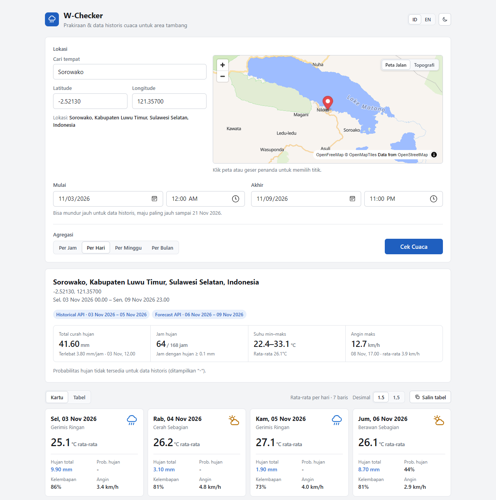

# W-Checker

Cek cuaca **per jam dan historis** untuk area tambang dalam satu halaman. Prakiraan (sampai 15 hari ke depan) dan data historis (mundur sampai 1940) diambil otomatis dari sumber yang tepat lalu digabung, siap disalin ke Excel.

*Hourly forecast and historical weather for mine sites in a single page. Forecast and archive data are routed and merged automatically, with a map location picker and Excel-ready tables. Static HTML/CSS/JS (ES modules), no build step, no backend, no API key.*



## Fitur

- **Satu rentang tanggal, sumber data otomatis.** Tanggal sebelum hari ini memakai Open-Meteo Historical API, hari ini dan ke depan memakai Forecast API. Rentang yang melewati hari ini dipecah dan digabung otomatis.
- **Pilih lokasi tiga cara yang saling tersinkron:** cari nama tempat (dengan daftar pilihan), ketik latitude/longitude, atau klik/geser penanda di peta. Ada layer **Peta Jalan** dan **Topografi**.
- **Agregasi per jam, hari, minggu, atau bulan**, ditampilkan sebagai kartu atau tabel.
- **Ringkasan rentang:** total curah hujan, jam hujan, suhu min–maks, dan angin maksimum.
- **Salin tabel ke Excel** dengan satu klik, dengan pilihan pemisah desimal titik atau koma (untuk Excel berformat Indonesia).
- **Bahasa Indonesia / English** dan **tema terang / gelap**.
- Preferensi (bahasa, tema, desimal, lokasi terakhir) diingat per browser.

## Cara pakai

Pengguna cukup membuka link aplikasi (di-host di Cloudflare) dengan browser modern (Chrome, Edge, Firefox). Tidak perlu install apa pun.

Untuk pengembangan, buka folder ini di VS Code lalu jalankan **Live Server** (port sudah diatur ke 5502 di `.vscode/settings.json`), lalu akses `http://127.0.0.1:5502/index.html`. Server statis lain juga bisa. JavaScript-nya berupa ES modules, jadi `index.html` **tidak bisa** dibuka langsung dengan klik dua kali (`file://`), karena browser memblokir modul dari `file://`.

Deploy cukup mengunggah isi folder apa adanya (tanpa build step).

Butuh koneksi internet untuk data cuaca, pencarian tempat, dan peta.

## Sumber data & batasan

| Layanan | Dipakai untuk | Catatan |
|---|---|---|
| [Open-Meteo Forecast API](https://open-meteo.com/en/docs) | Hari ini s/d 15 hari ke depan | Menyediakan probabilitas hujan |
| [Open-Meteo Historical API](https://open-meteo.com/en/docs/historical-weather-api) | Sebelum hari ini (sejak 1940) | **Tidak** menyediakan probabilitas hujan (ditampilkan `-`) |
| [Open-Meteo Geocoding API](https://open-meteo.com/en/docs/geocoding-api) | Cari nama tempat | |
| [OpenFreeMap](https://openfreemap.org) + [MapLibre GL JS](https://maplibre.org) | Peta jalan | Gratis, tanpa API key |
| [OpenTopoMap](https://opentopomap.org) | Peta topografi | Server relawan, bisa sesekali tidak tersedia |

> **Penting soal lisensi Open-Meteo:** API gratis Open-Meteo hanya untuk **pemakaian non-komersial** (maks. 10.000 panggilan/hari, 5.000/jam, 600/menit) dan datanya berlisensi CC BY 4.0. Untuk pemakaian komersial atau di lingkungan perusahaan, gunakan [paket berbayar Open-Meteo](https://open-meteo.com/en/pricing). Lihat [syarat dan ketentuannya](https://open-meteo.com/en/terms).

## Struktur repo

```
index.html               Markup halaman
css/style.css            Semua gaya, termasuk token tema terang/gelap
js/main.js               Entry point: inisialisasi, event, alur Cek Cuaca, bahasa/tema/desimal
js/core.js               State bersama, preferensi (localStorage), t(), fmt(), helper tanggal
js/strings.js            Semua teks UI (ID/EN) dan deskripsi kode cuaca
js/api.js                Open-Meteo: batas API, geocoding, routing forecast/archive
js/data.js               Filter, agregasi, ringkasan (fungsi murni)
js/location.js           Lokasi & pencarian tempat
js/map.js                Peta MapLibre
js/render.js             Kartu, tabel, ringkasan, salin tabel
docs/SYSTEM_DESIGN.md    Desain sistem: arsitektur, alur data, keputusan desain
docs/screenshot.png      Screenshot untuk README
.vscode/settings.json    Port Live Server (5502)
LICENSE                  Lisensi MIT
```

Penjelasan lengkap cara kerja aplikasi ada di [docs/SYSTEM_DESIGN.md](docs/SYSTEM_DESIGN.md).

## Atribusi

- Data cuaca: [Open-Meteo.com](https://open-meteo.com), CC BY 4.0
- Peta: [OpenFreeMap](https://openfreemap.org), © [OpenMapTiles](https://www.openmaptiles.org), data © [OpenStreetMap contributors](https://www.openstreetmap.org/copyright)
- Topografi: © [OpenTopoMap](https://opentopomap.org) (CC-BY-SA), SRTM

## Lisensi

Kode aplikasi berlisensi [MIT](LICENSE). Data dan peta mengikuti lisensi masing-masing penyedia di atas.
