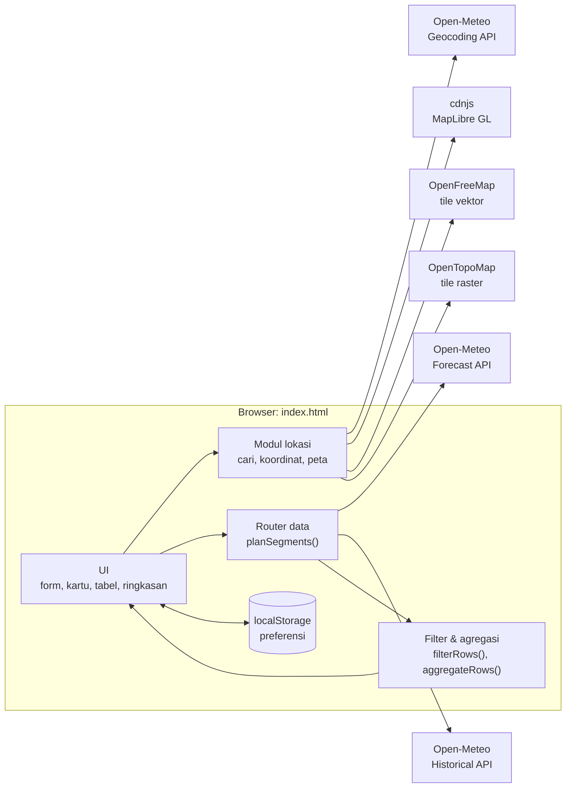
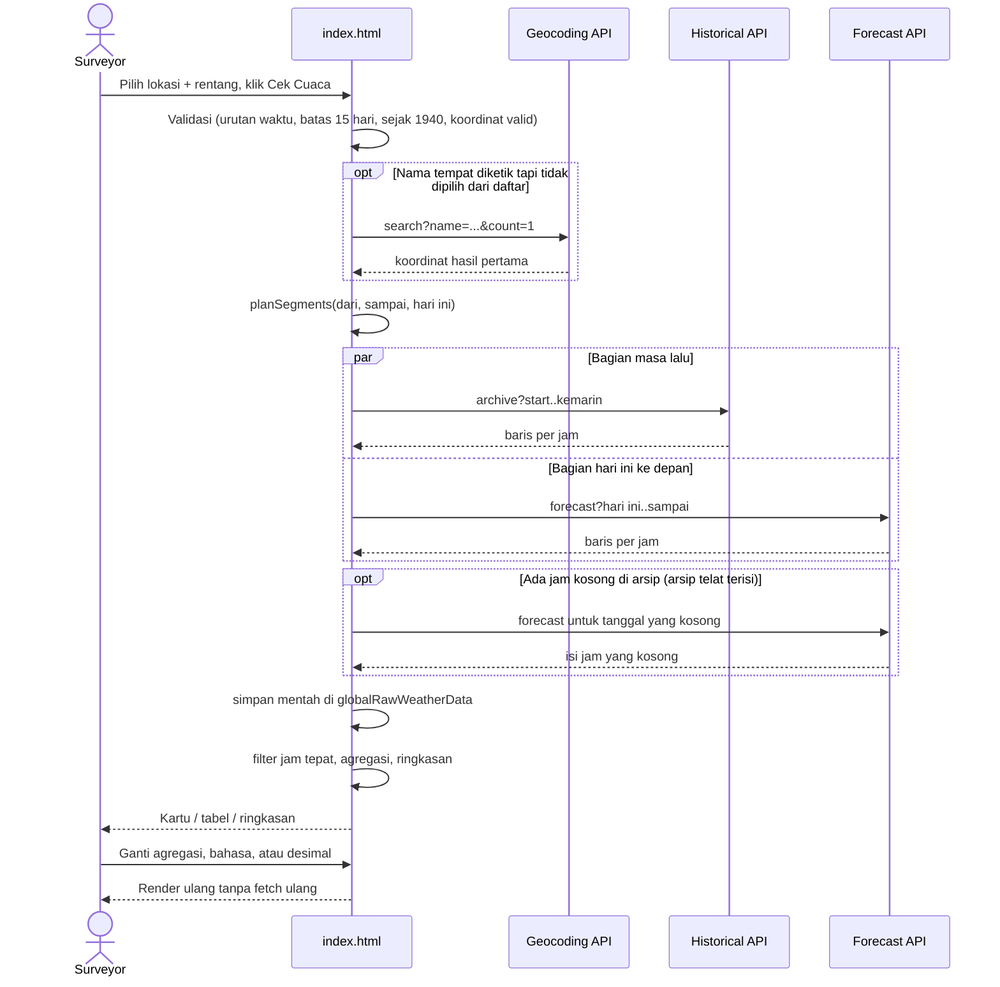
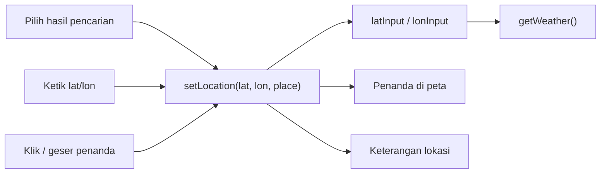

# W-Checker: System Design

Dokumen ini menjelaskan cara kerja W-Checker, alasan di balik tiap keputusan desain, dan pola yang bisa dipakai ulang untuk aplikasi lain. Bagian 12 berisi checklist ringkas untuk memulai proyek baru.

## Daftar isi

1. [Konteks & tujuan](#1-konteks--tujuan)
2. [Prinsip desain](#2-prinsip-desain)
3. [Arsitektur](#3-arsitektur)
4. [Alur data](#4-alur-data)
5. [Routing sumber data: forecast vs archive](#5-routing-sumber-data-forecast-vs-archive)
6. [Model data & agregasi](#6-model-data--agregasi)
7. [State & preferensi](#7-state--preferensi)
8. [Lokasi: pencarian, koordinat, peta](#8-lokasi-pencarian-koordinat-peta)
9. [Lapisan UI: tema, bahasa, angka](#9-lapisan-ui-tema-bahasa-angka)
10. [Ketahanan & mode gagal](#10-ketahanan--mode-gagal)
11. [Catatan keputusan (ADR ringkas)](#11-catatan-keputusan-adr-ringkas)
12. [Checklist untuk aplikasi berikutnya](#12-checklist-untuk-aplikasi-berikutnya)
13. [Pengujian](#13-pengujian)
14. [Batasan & ide pengembangan](#14-batasan--ide-pengembangan)

---

## 1. Konteks & tujuan

**Pengguna:** surveyor di area tambang. Mereka butuh data cuaca per jam untuk perencanaan kerja (prakiraan) dan untuk laporan atau analisis kejadian (historis), lalu menempelkan hasilnya ke Excel.

**Masalah awal:** ada dua versi aplikasi terpisah. v3s hanya bisa prakiraan, sedangkan v4 bisa histori tapi crash di tampilan per jam dan salah memilih API untuk rentang yang melewati hari ini. Pengguna harus tahu kapan memakai file yang mana.

**Tujuan:** satu halaman yang menerima **lokasi + rentang waktu apa pun** dan mengurus sendiri dari mana datanya diambil.

**Non-tujuan:** tidak ada login, tidak ada server sendiri, dan tidak ada penyimpanan data di sisi server.

## 2. Prinsip desain

| Prinsip | Wujudnya di W-Checker |
|---|---|
| **Nol infrastruktur** | Satu file `index.html`. Tidak ada build step, backend, atau API key. Bisa dibuka langsung dari folder. |
| **Pengguna cukup menyatakan *apa* yang diinginkan** | Pengguna memilih rentang tanggal, aplikasi yang memilih API. Pengguna memilih lokasi dengan cara apa pun, aplikasi menyimpannya sebagai koordinat. |
| **Jujur soal asal data** | Label sumber per rentang tanggal, catatan kalau probabilitas hujan tidak tersedia, catatan kalau ada data yang diisi dari sumber lain. Nilai kosong tampil `-`, bukan `0`. |
| **Gagal sebagian, bukan gagal total** | Peta gagal dimuat? Pencarian dan input koordinat tetap jalan. Tile topografi gagal? Ada pesan dan bisa ganti layer. |
| **Format keluaran mengikuti alat kerja pengguna** | Tabel disalin sebagai TSV + HTML, urutan kolom stabil, ada pilihan desimal koma untuk Excel berformat Indonesia. |
| **Preferensi diingat, data tidak** | Bahasa, tema, desimal, dan lokasi terakhir disimpan di `localStorage`. Data cuaca selalu diambil segar. |

## 3. Arsitektur

Aplikasi berjalan sepenuhnya di browser. Semua layanan eksternal dipanggil langsung dari klien.



**Bagian-bagian dalam `index.html`** (urutan sesuai di file):

| Bagian | Isi |
|---|---|
| `<head>` script kecil | Menerapkan tema tersimpan sebelum halaman digambar, supaya tidak berkedip. |
| CSS | Design token di `:root`, override tema gelap, komponen, dan aturan responsif. |
| HTML | Panel form (lokasi, rentang, agregasi), area pesan, panel hasil, footnote. |
| `STRINGS`, `WEATHER_DESC` | Semua teks UI dalam ID dan EN. |
| Preferensi & helper | `readPref`/`writePref`, `t()`, `fmt()`, helper tanggal lokal. |
| Peta & lokasi | `loadMapLibrary()`, `initMap()`, `setLocation()`, pencarian tempat. |
| Router data | `planSegments()`, `fetchSegment()`, `fetchAllRows()`. |
| Agregasi & ringkasan | `filterRows()`, `aggregateRows()`, `computeSummary()`. |
| Render | `displayWeather()`, `generateCardView()`, `generateTableView()`, `copyTable()`. |

## 4. Alur data



Poin penting: **data mentah disimpan sekali** (`globalRawWeatherData`). Semua perubahan tampilan (agregasi, bahasa, pemisah desimal) cukup dihitung ulang dari data itu tanpa memanggil API lagi.

## 5. Routing sumber data: forecast vs archive

### Batas tiap API (dicek langsung ke API, November 2026)

| API | Rentang tanggal | `precipitation_probability` | Catatan |
|---|---|---|---|
| Forecast | ±92 hari ke belakang s/d **15 hari ke depan** | Ada | Di luar rentang membalas `{"error":true,"reason":"... out of allowed range ..."}` |
| Historical (archive) | 1940 s/d kemarin | **Selalu `null`** | Hari-hari terakhir bisa masih kosong (reanalysis belum selesai) |

### Aturan pemecahan

```
           kemarin │ hari ini
 ──────────────────┼─────────────────────────▶ waktu
 [ Historical API ]│[ Forecast API (≤ +15 hr) ]

 dari ≤ kemarin   → segmen archive: dari .. min(sampai, kemarin)
 sampai ≥ hari ini → segmen forecast: max(dari, hari ini) .. sampai
```

Rentang yang melewati hari ini menghasilkan **dua segmen** yang diambil paralel (`Promise.all`) lalu digabung. Kalau ada jam arsip yang kosong dan tanggalnya masih dalam jangkauan Forecast API (≤ 92 hari ke belakang), jam-jam itu diisi dari Forecast API dan jumlahnya ditampilkan sebagai catatan.

### Waktu & zona waktu

- API dipanggil dengan `timezone=auto`, jadi jam yang dikembalikan adalah **jam lokal lokasi**.
- Jam dari API dan jam input sama-sama di-parse dengan `new Date("YYYY-MM-DDTHH:MM")`, sehingga perbandingannya konsisten sebagai "jam dinding".
- "Hari ini" dihitung dengan tanggal lokal (`toISODate`), **bukan** `toISOString()`. `toISOString()` memberi tanggal UTC, yang salah hari sebelum jam 08:00 WITA. Ini salah satu bug di versi lama.

## 6. Model data & agregasi

### Satu baris per jam (hasil normalisasi `fetchSegment`)

```js
{
  time: "2026-11-05T06:00",  // jam lokal lokasi
  temp: 25.4,                 // °C        (bisa null)
  humidity: 91,               // %         (bisa null)
  precip: 0.0,                // mm/jam    (bisa null)
  prob: null,                 // %         (null untuk data historis)
  code: 2,                    // kode WMO  (bisa null)
  wind: 7.6,                  // km/h      (bisa null)
  source: "archive"           // "archive" | "forecast"
}
```

**Aturan emas: semua angka boleh `null`.** Penyebab crash di v4 adalah `null.toFixed()`. Sekarang semua angka melewati `fmt()`, yang mengubah `null` menjadi `-`.

### Aturan agregasi (`aggregateRows`)

| Kolom | Per hari/minggu/bulan | Kenapa |
|---|---|---|
| Suhu, kelembapan, angin, probabilitas | **Rata-rata nilai yang tidak null** | `null` dihitung sebagai 0 akan menurunkan rata-rata secara palsu |
| Curah hujan | **Jumlah** | Total hujan per periode lebih bermakna daripada rata-rata |
| Cuaca dominan | **Modus** kode WMO | Kondisi yang paling sering terjadi |
| Kelompok minggu | Dimulai **Senin** | Konvensi kerja di Indonesia |

Semua kolom kosong dalam satu periode menghasilkan `null` (tampil `-`), bukan `0`.

### Ringkasan rentang (`computeSummary`)

Dihitung dari **data per jam** dalam rentang terpilih, jadi **tidak berubah** saat agregasi diganti: total hujan, jam hujan (≥ 0,1 mm/jam), jam terlebat, suhu min/maks/rata-rata, dan angin maksimum beserta waktunya. Min/maks memakai `reduce`, bukan `Math.min(...arr)`, karena spread argumen bisa melebihi batas untuk rentang histori puluhan tahun.

## 7. State & preferensi

| State | Tempat | Isi |
|---|---|---|
| Lokasi | `latInput` / `lonInput` | **Satu-satunya sumber kebenaran** untuk koordinat |
| Nama tempat | `selectedPlace` | Label saja; dihapus kalau titik digeser lewat peta atau input manual |
| Data mentah | `globalRawWeatherData` | Baris per jam + segmen + rentang + lokasi; dipakai ulang untuk render |
| Tampilan aktif | `currentResultTab`, radio agregasi | Kartu/tabel, jam/hari/minggu/bulan |
| Preferensi | `localStorage` `wchecker.*` | `lang`, `theme`, `decimalSeparator`, `lastLocation` |

Pola preferensi:

- Setiap akses `localStorage` dibungkus `try/catch`, karena bisa tidak tersedia (mode privat, kebijakan perusahaan). Aplikasi tetap jalan dengan nilai bawaan.
- Tema diterapkan oleh script kecil di `<head>` **sebelum** CSS dan body dirender, supaya tidak ada kedipan tema terang saat halaman dibuka.
- Yang disimpan hanya kenyamanan per pengguna. Data cuaca tidak pernah disimpan.

## 8. Lokasi: pencarian, koordinat, peta

### Satu panel, satu sumber kebenaran

Versi awal memakai tiga tab (Nama Kota / Koordinat / Peta) dan aplikasi diam-diam memakai tab yang aktif. Itu membingungkan: pilih titik di peta, pindah tab, dan yang dipakai ternyata kota. Sekarang ketiganya tampil bersamaan, dan **semua jalur masuk lewat satu fungsi**:



Peta yang selalu tampil juga berfungsi sebagai **pengecekan visual**: salah ketik koordinat (lupa tanda minus, lat/lon tertukar) langsung terlihat sebagai penanda yang nyasar.

### Pencarian tempat (combobox)

- **Debounce** 350 ms dan minimal 2 karakter, supaya tidak memanggil API di setiap ketukan.
- **Penangkal balapan respons:** setiap pencarian menaikkan `searchSeq`. Respons yang datang terlambat (bukan dari pencarian terbaru) dibuang, sehingga hasil lama tidak menimpa hasil baru.
- Daftar menampilkan nama, wilayah, dan koordinat, karena nama yang sama bisa ada di banyak tempat ("Kendari" muncul di Sulawesi Tenggara, Kalimantan Utara, dan India).
- Bisa dipakai dengan keyboard (panah atas/bawah, Enter, Esc). Hasil dipilih saat `mousedown`, bukan `click`, supaya terpilih sebelum input kehilangan fokus.
- Kebiasaan lama tetap didukung: teks diketik tapi tidak dipilih dari daftar, lalu Cek Cuaca ditekan, maka hasil pertama yang dipakai.

### Peta

- **MapLibre GL** dari cdnjs, dimuat lewat `loadMapLibrary()`. Kalau CDN atau WebGL tidak tersedia, peta menampilkan pesan dan bagian lain tetap jalan.
- **Peta dasar: OpenFreeMap** (tile vektor). Gratis, tanpa API key, tanpa batas, boleh komersial, dan mengizinkan akses dari `file://` (CORS `*`).
- **Layer topografi: OpenTopoMap** (raster). Server relawan, jadi ada pesan khusus kalau gagal.
- Urutan koordinat di MapLibre adalah **`[lon, lat]`**, kebalikan dari kebiasaan menulis lat, lon.
- Penanda (`Marker`) adalah elemen DOM, jadi tidak hilang saat style peta diganti.

## 9. Lapisan UI: tema, bahasa, angka

### Design token & tema

Semua warna adalah variabel CSS di `:root`. Tema gelap mendefinisikan ulang variabel yang sama di dua tempat:

```css
:root { --bg: ...; --text: ...; }                      /* terang (bawaan) */
:root[data-theme="dark"] { ... }                       /* gelap, dipilih pengguna */
@media (prefers-color-scheme: dark) {
  :root:not([data-theme="light"]) { ... }              /* gelap, ikut perangkat */
}
```

Dengan pola ini, tanpa pilihan tersimpan tema mengikuti perangkat, sedangkan pilihan eksplisit pengguna selalu menang. Komponen tidak pernah memakai warna mentah, hanya token.

### Bahasa (i18n tanpa library)

- Semua teks ada di `STRINGS.id` / `STRINGS.en` dan dibaca lewat `t(key, params)` dengan placeholder `{nama}`. Kunci yang tidak ada jatuh ke bahasa Indonesia, lalu ke nama kuncinya.
- Markup statis memakai atribut `data-i18n`, `data-i18n-html`, `data-i18n-placeholder`, `data-i18n-title`, dan `data-i18n-aria`. `applyLanguage()` mengisi semuanya lalu merender ulang hasil.
- Tanggal diformat dengan locale sesuai bahasa (`id-ID` / `en-GB`). Pencarian tempat juga mengirim `language=` sehingga nama wilayah ikut berganti bahasa.

### Angka & salin ke Excel

- `fmt(v, digits)` adalah **satu-satunya** jalan angka ke layar: menangani `null` dan menerapkan pemisah desimal pilihan pengguna. Koordinat sengaja tetap memakai titik.
- `copyTable()` menulis dua format sekaligus ke clipboard, yaitu `text/plain` (TSV) dan `text/html` (tabel), sehingga ditempel ke Excel langsung menjadi sel. Kalau Clipboard API ditolak, ada cadangan `execCommand('copy')`.
- Urutan kolom tabel adalah "kontrak" dengan template Excel pengguna. Jangan diubah tanpa koordinasi.

### Kinerja tampilan

Tampilan kartu dibatasi 500 kartu (`MAX_CARDS`) dengan catatan untuk memakai tabel atau agregasi. Tabel tetap menampilkan semua baris, dengan header yang menempel saat di-scroll.

## 10. Ketahanan & mode gagal

| Kegagalan | Perilaku |
|---|---|
| Tanggal akhir > 15 hari ke depan | Ditolak sebelum fetch, dengan pesan berisi tanggal maksimum |
| Rentang terbalik / kosong / sebelum 1940 | Ditolak sebelum fetch |
| Koordinat di luar ±90 / ±180 | Pesan "koordinat tidak valid" |
| Nama tempat tidak ditemukan | Pesan berisi teks yang dicari dan saran alternatif |
| API membalas `error: true` | `reason` dari API ditampilkan apa adanya, diawali nama API-nya |
| Arsip belum terisi untuk hari-hari terakhir | Diisi dari Forecast API; jumlah jamnya dicatat di ringkasan |
| Probabilitas hujan tidak ada (historis) | Tampil `-`, rata-rata hanya dari nilai yang ada, ada catatan |
| CDN MapLibre gagal / WebGL tidak ada | Pesan di bawah peta; cari & koordinat tetap jalan |
| Tile peta gagal | Pesan di bawah peta, sesuai layer yang aktif |
| `localStorage` tidak tersedia | Preferensi tidak tersimpan, aplikasi tetap jalan |
| Clipboard API ditolak | Cadangan `execCommand('copy')`; tombol menampilkan berhasil/gagal |

## 11. Catatan keputusan (ADR ringkas)

| # | Masalah | Keputusan | Alasan |
|---|---|---|---|
| 1 | Dua file (v3s untuk prakiraan, v4 untuk histori) | Satu halaman dengan router `planSegments()` | Pengguna tidak perlu tahu batas tiap API |
| 2 | v4 memilih API hanya dari tanggal mulai | Pecah rentang di batas hari ini, ambil paralel, lalu gabung | Rentang "kemarin s/d minggu depan" jadi valid |
| 3 | v4 crash `null.toFixed()` | Semua angka nullable, lewat `fmt()`; agregasi abaikan `null` | Archive API tidak punya probabilitas hujan |
| 4 | "Hari ini" salah sebelum 08:00 WITA | Tanggal lokal (`toISODate`), bukan `toISOString()` | `toISOString()` memakai UTC |
| 5 | Server tile OpenStreetMap membalas "403 Access blocked" untuk pengguna | Pindah ke OpenFreeMap + MapLibre | Server OSM dijalankan relawan dan bisa memblokir kapan saja; OpenFreeMap memang dibuat untuk dipakai aplikasi lain |
| 6 | Tiga tab lokasi membingungkan | Satu panel, koordinat sebagai sumber kebenaran | Tidak ada lagi "tab mana yang dipakai" |
| 7 | Excel berformat Indonesia membaca `25.4` sebagai teks | Pilihan desimal koma, diterapkan di `fmt()` | Yang terlihat sama dengan yang tersalin |
| 8 | Menyalin tabel manual rawan salah blok | Tombol salin TSV + HTML | Langsung jadi sel di Excel |
| 9 | Ribuan kartu membuat browser berat | Batas 500 kartu, tabel tetap lengkap | Rentang histori panjang tetap responsif |
| 10 | Library peta besar tapi tidak semua orang butuh | Dimuat dinamis dengan penanganan gagal | Aplikasi inti tidak ikut gagal kalau CDN bermasalah |

## 12. Checklist untuk aplikasi berikutnya

Pola dari W-Checker yang bisa dipakai ulang:

**Data & API**
- [ ] Cek batas setiap API **langsung ke API-nya** (rentang tanggal, field yang tersedia, format error), jangan hanya dari dokumentasi.
- [ ] Baca **syarat pemakaian** (komersial vs non-komersial, rate limit, atribusi) sebelum memilih layanan.
- [ ] Normalisasi respons ke satu bentuk baris; anggap **semua field bisa null**.
- [ ] Simpan data mentah sekali; turunkan semua tampilan darinya tanpa fetch ulang.
- [ ] Waspadai tanggal: pakai tanggal lokal, jangan `toISOString()` untuk "hari ini".

**Interaksi**
- [ ] Satu sumber kebenaran untuk setiap input penting; semua jalur masuk lewat satu fungsi (`setX()`).
- [ ] Autocomplete: debounce + nomor urut request untuk membuang respons basi.
- [ ] Dukung kebiasaan lama pengguna saat mengubah alur (misalnya ketik lalu langsung submit).
- [ ] Validasi sebelum fetch, dengan pesan yang menyebut nilai dan batasnya.

**UI**
- [ ] Warna hanya dari design token; tema gelap = definisi ulang token, bukan CSS terpisah.
- [ ] Terapkan tema tersimpan di `<head>` untuk mencegah kedipan.
- [ ] Semua teks lewat `t()` sejak awal; menambah bahasa nanti jauh lebih murah.
- [ ] Satu fungsi format angka untuk semua keluaran.
- [ ] Sesuaikan format keluaran dengan alat kerja pengguna (Excel, locale).
- [ ] Tampilkan asal data dan keterbatasannya di UI.

**Ketahanan**
- [ ] Library besar/opsional dimuat dinamis dengan penanganan gagal.
- [ ] Bungkus `localStorage` dan Clipboard API dengan `try/catch` dan cadangan.
- [ ] Hindari layanan gratis yang dijalankan relawan untuk beban produksi; pilih yang memang menyediakan untuk pihak ketiga.

## 13. Pengujian

Proyek ini tidak punya framework test. Selama pengembangan dipakai dua teknik yang cukup ringan untuk aplikasi satu file:

1. **Logika di Node.js dengan DOM tiruan.** Isi `<script>` utama diambil dari `index.html`, dijalankan dengan objek `document`/`localStorage` tiruan, lalu fungsi seperti `getWeather()` dipanggil **terhadap API asli**. Skenario yang diuji: hanya prakiraan, histori setahun penuh, rentang yang melewati hari ini, tanggal melewati batas, arsip kosong (disimulasikan dengan membungkus `fetch`), kedua bahasa, desimal koma, dan input lokasi yang salah.
2. **Tampilan dengan Edge headless lewat Chrome DevTools Protocol.** Halaman dibuka dari `file://` dengan profil browser baru (tanpa cache), skenario dijalankan otomatis, lalu dicatat semua respons jaringan ≥ 400 dan error console, kemudian diambil screenshot di lebar desktop dan 390 px. Opsi `--screenshot` biasa tidak cukup untuk MapLibre karena tile vektor dimuat lewat web worker yang tidak ditunggu.

## 14. Batasan & ide pengembangan

**Batasan saat ini**
- API gratis Open-Meteo hanya untuk pemakaian **non-komersial** (maks. 10.000 panggilan/hari). Untuk pemakaian perusahaan, pakai paket berbayar; endpoint berbayar memakai API key.
- Probabilitas hujan tidak tersedia untuk data historis (keterbatasan sumber data).
- Data historis adalah reanalysis model (bukan pengukuran stasiun di lokasi), dan di sekitar batas hari ini sumber data berganti sehingga nilai bisa sedikit melompat.
- Butuh internet; tidak ada mode offline.

**Ide**
- Ekspor CSV/XLSX langsung, selain salin ke clipboard.
- Grafik curah hujan per jam/hari (garis waktu dengan penanda batas historis vs prakiraan).
- Daftar lokasi favorit (beberapa site tambang) selain lokasi terakhir.
- Ambang peringatan (misalnya hujan ≥ X mm/jam atau angin ≥ Y km/h) dengan penanda di tabel.
- Dukungan API key Open-Meteo berbayar lewat pengaturan.
